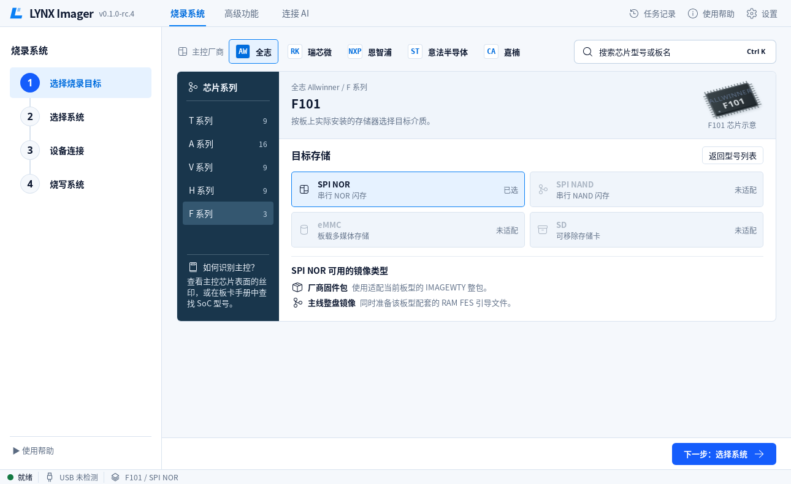

# LYNX Imager

在 Windows 或 Ubuntu 上给开发板烧写系统镜像。选好主控芯片和板上的存储介质，向导会列出适用的镜像类型，以及这次烧录需要的引导文件。

**v0.1-rc5 预发行版**　 [下载 Windows x64 安装包（.exe）](https://github.com/dshanpi/lynx-imager/releases/download/v0.1-rc5/LYNX-Imager_0.1.0-rc.5_windows-x64-setup.exe) · [下载 Ubuntu amd64 安装包（.deb）](https://github.com/dshanpi/lynx-imager/releases/download/v0.1-rc5/LYNX-Imager_0.1.0-rc.5_linux-amd64.deb) · [发行说明与校验文件](https://github.com/dshanpi/lynx-imager/releases/tag/v0.1-rc5)



## 工作区

- **烧录系统**：按厂商、系列、芯片和目标存储选择路线，再选镜像、连接设备、确认写入并校验。
- **高级功能**：打开现有专业工作台，配置 SPI NOR、NAND、eMMC、Loader、物理回读和结束动作。
- **连接 AI**：进入现有 AI 配置与监督中心；AI 只能提出动作，设备作用域、门禁和人工确认由 LYNX 决定。

## 安装与更新

Windows x64 用户下载 NSIS 安装包，Ubuntu amd64 用户下载 Debian 安装包。安装包、独立 OTA 签名和 SHA-256 校验值随版本提供。[GitHub Releases](https://github.com/dshanpi/lynx-imager/releases)

应用启动后会检查更新，也可在设置中手动检查。发现较高版本后，经用户确认下载完整包，并用 Imager 内置公钥校验。Ubuntu 安装 Debian 更新时可能要求系统授权。[发布门禁](docs/engineering/imager-release.md)

## 开发

桌面前端使用 React、TypeScript 和 Vite，后端使用 Rust 和 Tauri 2。烧录和设备通信沿用 OpenixCLI、FEL/FES、USB、串口、ADB 和 MCP IPC 接口。

```bash
npm install
npm run typecheck
npm run test:ui-contract
npm run dev
```

`npm run dev` 只启动 Vite 前端预览。完整桌面运行需要 Tauri 环境：

```bash
npm run tauri -- dev
```

完整桌面应用必须通过 Tauri 窗口和 Rust 后端验证，不能把浏览器预览当成软件验收。

## 目录

```text
src/Components/Imager/   LYNX Imager 三工作区入口和烧录系统向导
src/Components/Workbench/现有专业工作台与硬件交互
src-tauri/src/            Rust IPC、硬件安全门禁、OpenixCLI 和任务执行
prototype/                原始离线 UI 原型和 17 页面状态机
docs/design/              产品流程、页面效果图、安全规则和验收标准
```

## 设备安全边界

任何擦除、写入、校验、重启、电源和串口动作都必须经过后端硬件安全门禁。基础向导不会自动选择其他设备、自动重试失败任务或用协议进度冒充系统启动成功。写入完成、物理回读、重启完成和启动验证分别记录。

## 当前状态

本阶段已完成真实桌面工程迁移和基础向导接入：设备列表使用 `workbench_list_devices`，烧录使用现有 `workbench_start_flash`，任务状态订阅现有 `workbench-task-event`。高级和 AI 工作区通过既有工作台进入；后续继续优化 UI 和补齐真实桌面验收。
