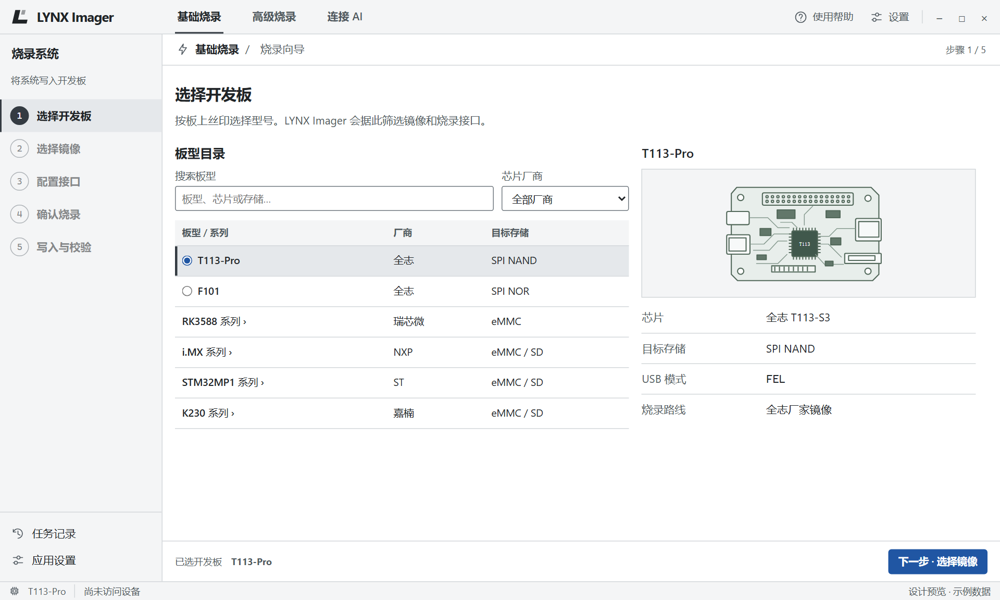
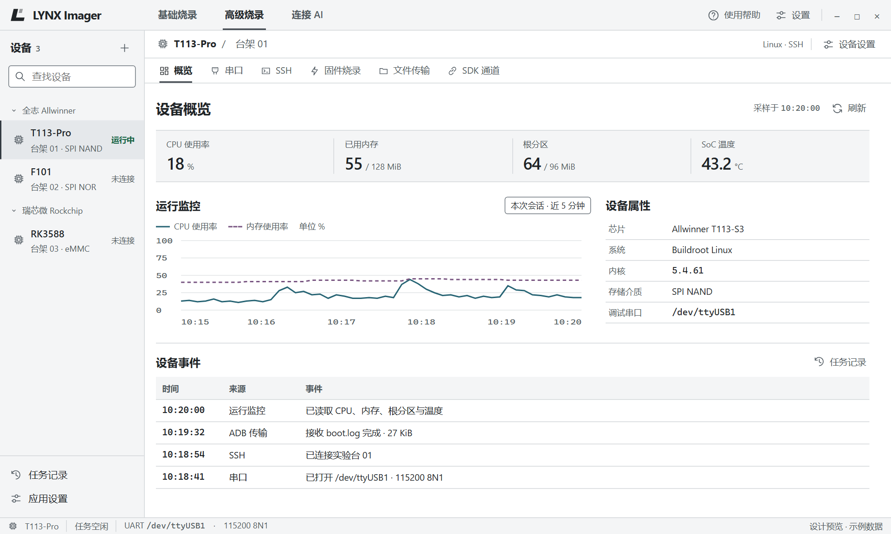

# LYNX Imager 桌面工作台效果图

> 历史效果图，仅供参考；2026-11-24 起不再约束重新设计的页面。

本轮设计评审包括 26 个页面或状态，每个状态均提供原版 LYNX - Light 和 LYNX - Dark 的两版 PNG。每张图按 1280 × 768 逻辑像素排版，导出分辨率为 1920 × 1152。图中设备、端口、日志和曲线使用示例数据。

[浅深色配色样张](color-system.png) · [历史样式说明](../README.md)

## 业务流程与阅读顺序

- **基础烧录**。选具体板型，选择适配系统或本地镜像，绑定目标接口，核对覆盖范围，再写入与校验。缺少匹配 Loader 时停在预检。结果页分别交代写入、校验、重启指令和启动证据。
- **高级烧录**。先选一台已保存的设备，再切换概览、UART、SSH、文件传输或固件工具。概览汇总当次遥测；带时间的曲线使用当次会话的多个采样点。设备断连后，最近一次数据应保留其时间。
- **连接 AI**。按照客户端运行位置选择本机 MCP 或远端 SDK，核对该端的验证结果后复制地址。需要写入时，审批页展示目标、物理接口和镜像指纹。未勾选确认时，写入授权按钮禁用。
- **共用入口**。任务记录按板卡和阶段追溯，应用设置承载主题、设备发现与更新选项。

## 基础烧录

| 页面或状态 | 浅色 | 深色 |
| --- | --- | --- |
| 选择开发板 | [查看原图](basic-board.png) | [查看原图](basic-board-dark.png) |
| 选择系统与板型资源 | [查看原图](basic-system.png) | [查看原图](basic-system-dark.png) |
| 选择本地镜像 | [查看原图](basic-file.png) | [查看原图](basic-file-dark.png) |
| 绑定已保存的接口 | [查看原图](basic-interface.png) | [查看原图](basic-interface-dark.png) |
| Maskrom 缺少 Loader | [查看原图](basic-loader.png) | [查看原图](basic-loader-dark.png) |
| 核对写入目标 | [查看原图](basic-confirm.png) | [查看原图](basic-confirm-dark.png) |
| 写入进度 | [查看原图](basic-progress.png) | [查看原图](basic-progress-dark.png) |
| 写入完成与启动待确认 | [查看原图](basic-success.png) | [查看原图](basic-success-dark.png) |
| 写入中断与恢复 | [查看原图](basic-failure.png) | [查看原图](basic-failure-dark.png) |

## 高级烧录

| 页面或状态 | 浅色 | 深色 |
| --- | --- | --- |
| 设备概览与运行监控 | [查看原图](advanced-overview.png) | [查看原图](advanced-overview-dark.png) |
| 串口终端 | [查看原图](advanced-serial.png) | [查看原图](advanced-serial-dark.png) |
| SSH 终端 | [查看原图](advanced-ssh.png) | [查看原图](advanced-ssh-dark.png) |
| ADB 文件传输 | [查看原图](advanced-files.png) | [查看原图](advanced-files-dark.png) |
| F101 · SPI NOR | [查看原图](advanced-spinor.png) | [查看原图](advanced-spinor-dark.png) |
| RK3588 · eMMC | [查看原图](advanced-rockchip.png) | [查看原图](advanced-rockchip-dark.png) |
| 预检阻断 | [查看原图](advanced-preflight.png) | [查看原图](advanced-preflight-dark.png) |
| 设备设置 | [查看原图](device-settings.png) | [查看原图](device-settings-dark.png) |

## 连接 AI

| 页面或状态 | 浅色 | 深色 |
| --- | --- | --- |
| 本机 MCP 地址与客户端配置 | [查看原图](ai-local.png) | [查看原图](ai-local-dark.png) |
| 远端 SDK 与两端端点 | [查看原图](ai-remote.png) | [查看原图](ai-remote-dark.png) |
| 模型服务 | [查看原图](ai-services.png) | [查看原图](ai-services-dark.png) |
| 策略与安全 | [查看原图](ai-policy.png) | [查看原图](ai-policy-dark.png) |
| 烧录请求审批 | [查看原图](ai-approval.png) | [查看原图](ai-approval-dark.png) |
| 通知 | [查看原图](ai-notifications.png) | [查看原图](ai-notifications-dark.png) |

## 共用入口

| 页面或状态 | 浅色 | 深色 |
| --- | --- | --- |
| 任务记录 | [查看原图](records.png) | [查看原图](records-dark.png) |
| 应用设置 | [查看原图](settings.png) | [查看原图](settings-dark.png) |
| 主题样式与已选主题 | [查看原图](settings-theme.png) | [查看原图](settings-theme-dark.png) |

## 检查范围

布局检查覆盖 1090 × 720、1280 × 768、1440 × 900、1920 × 1080 四个逻辑窗口尺寸，分别核对整窗与内容区的水平溢出、按钮及表格文字的裁切、底部操作区的可见性。两个主题共 208 个页面尺寸组合。

渲染图展示拟议交互。采集接口只返回单次快照时，历史曲线应随会话采样逐步出现。接口配置只证明已有绑定，设备身份和烧录模式仍须以本次后端预检的结果为准。USB 脱离、重启指令已发送、系统启动验证分别记录。原生窗口交互、真实设备烧写和 AI 调用的验收在界面实现后执行。
