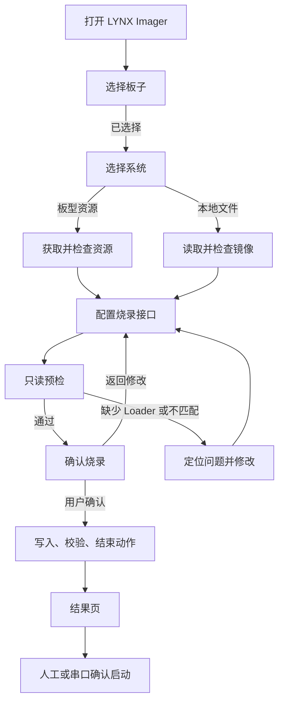
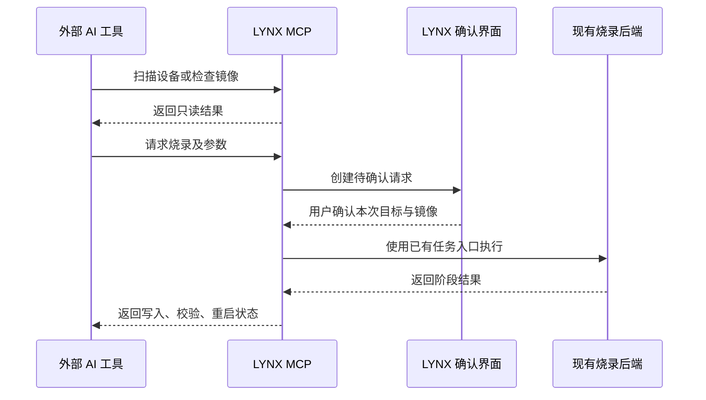

# 业务流程与使用逻辑

## 1. 基础烧录主流程



## 2. 状态传递

流程中持续保存以下任务上下文：

```text
boardModel
platform
imageSource
imagePathOrResource
imageFingerprint
route
targetDeviceIdentity
deviceMode
loaderFiles
storageTarget
verifyPolicy
postAction
preflightResult
confirmationState
taskResult
```

更换板子、镜像、目标设备、Loader 或关键参数时，旧的预检结果和破坏性确认必须失效。

## 3. 基础与高级之间

从基础烧录进入高级烧录时，带入当前板子、镜像、设备和可表达参数。高级页面显示当前路线，不重新猜测路线。

从高级返回基础时：

- 如果高级参数能由基础页面完整表达，保留选择并回到对应步骤。
- 如果存在基础页面无法表达的自定义项，提示差异，由用户选择留在高级模式或恢复基础配置。
- 不得静默丢弃擦除方式、结束动作、Loader 或目标存储。

## 4. AI 调用逻辑



AI 调用不得绕过与手动操作相同的目标绑定、镜像指纹、预检、确认、设备互斥和失败保护。

## 5. 资源与缓存逻辑

- 板型资源目录按具体板型提供。
- 无在线目录、网络失败或资源不存在时，仍可选择本地文件。
- 下载完成后先检查文件，再进入接口配置。
- 缓存只能复用文件，不能复用旧设备绑定或旧授权。
- 文件发生变化后必须重新计算指纹并重新预检。
